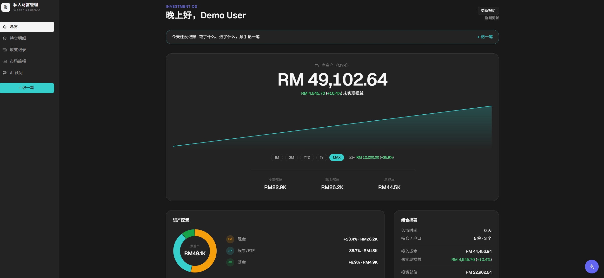
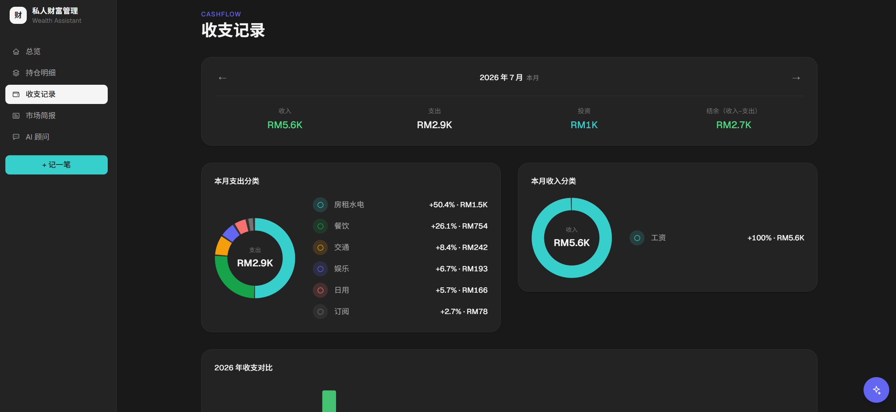
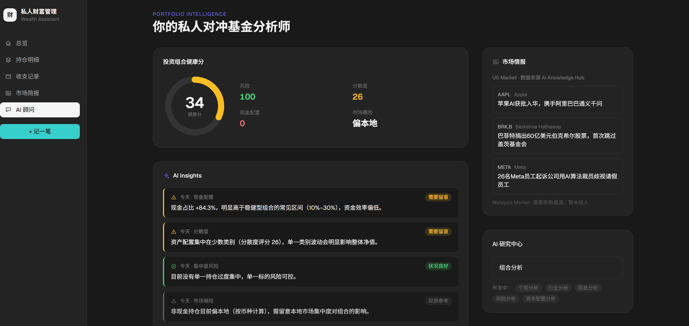

# WealthAssistant

A personal wealth management dashboard with an integrated AI advisor — tracks net
worth across brokerage, unit trust and bank accounts, imports bank statements, and
answers questions about your own portfolio.

**[Live demo](https://wealth-assistant-sable.vercel.app)** · `demo@wealthassistant.app` / `@#1122Demo`



| Cash flow | AI advisor |
|---|---|
|  |  |

> The demo runs on fictional data. Prices for US tickers are live. The AI advisor has a
> daily message cap so the shared demo key doesn't get drained.

---

## Why I built it

I was tracking my finances across a broker app, a unit trust portal, and a bank app
— three places, three currencies, no single view of net worth. Existing tools either
didn't support Malaysian unit trusts or wanted my banking credentials.

So the constraint was: work with whatever data I can export or type in, and be honest
when a price simply isn't available.

## What it does

| | |
|---|---|
| **Portfolio** | Multi-account holdings, allocation breakdown, historical net worth |
| **Cash flow** | Income/expense tracking, yearly view, keyword-based category rules |
| **Statement import** | Upload a bank statement (PDF or CSV) → parsed, deduplicated, auto-categorised |
| **AI advisor** | Chat that can read your actual holdings and record transactions |
| **Market brief** | Daily S&P 500 news, filtered for relevance to what you hold |
| **Settings** | Manage accounts, categories and the keyword rules that drive auto-categorisation |

## Engineering notes

The parts I'd want to talk through in an interview:

**Market data that degrades instead of failing.**
`lib/marketData.ts` is an orchestrator, not a client. Cache (1h for quotes, 12h for
FX) → primary provider → fallback provider → **stale cache**. If every provider is
down it returns the last known price flagged `cached: true` rather than throwing. A
portfolio dashboard that shows nothing is worse than one showing slightly old
numbers, so provider failure is a display concern, not an exception.

**Some prices don't exist, and the app says so.**
Malaysian unit trusts have no public quote API. Rather than scrape something fragile,
those holdings are explicitly manual-entry. Knowing which problems not to automate
mattered more here than the ones I did.

**Auth split across two runtimes.**
`auth.config.ts` is Edge-safe and used by middleware; `auth.ts` runs on Node and holds
the database client. Keeping them separate stops Prisma from being bundled into the
Edge runtime.

**Multi-tenant from the schema up.**
Every business model carries `userId` — added as a migration pair
(`add_user_multitenancy` then `require_user_id`) so existing rows could be backfilled
before the column became non-nullable. The AI agent's memory is scoped per user
through Mastra's request context, so one user's conversation can't leak into
another's.

**Two statement formats, one contract.**
The bank exports PDF and CSV, and neither is pleasant. The PDF has no debit/credit
column — direction has to be inferred by comparing each running balance against the
previous row. The CSV declares five columns in its header and then emits nine to
eleven, because the trailing ones carry the merchant details that categorisation
actually needs. Both parsers return the same `ParsedStatement` shape, so preview,
deduplication and import were written once.

**A phone is not a narrow desktop.**
The holdings table has eight columns. Shrinking it to phone width would leave every
column illegible, so below the `md` breakpoint it isn't a table at all — each holding
becomes a card that leads with the two numbers that matter (current value and P&L)
and demotes the rest. Where a table genuinely is the point, like the year-on-year
cash flow comparison, it scrolls horizontally instead of being redrawn.

**Reconciliation over confidence.**
The statement parser cross-checks its line items against the recorded total. If they
don't reconcile it falls back to a single correct line instead of showing an itemised
breakdown that adds up wrong. Wrong numbers in a finance app are worse than fewer
numbers.

**Migrations against a database that can't run them.**
Turso speaks libSQL over HTTP, so `prisma migrate` can't touch it — and Prisma's
table-rebuild migrations rely on `PRAGMA foreign_keys=OFF`, which the HTTP transport
rejects. `scripts/turso-apply-migration.ts` generates nothing itself: migrations are
authored locally against SQLite, then replayed remotely through libSQL's `migrate()`
mode, tracked in a `_turso_applied_migrations` table so reruns are safe.

## Stack

Next.js 16 (App Router) · React 19 · TypeScript · Tailwind v4 · shadcn/ui
Prisma 7 · Turso (libSQL) · Auth.js v5
Mastra agent framework · Vercel AI SDK · Langfuse tracing
Yahoo Finance · Frankfurter (FX) · Alpha Vantage (fallback)

## Running locally

```bash
npm install
cp .env.example .env.local     # fill in ADMIN_EMAIL, AUTH_SECRET at minimum
npx prisma migrate dev
npx tsx prisma/seed.ts         # demo data
npm run dev
```

Local development runs against a SQLite file; Turso is only used in deployment. See
`.env.example` for the full variable list.

## Status

Personal project, actively developed.
